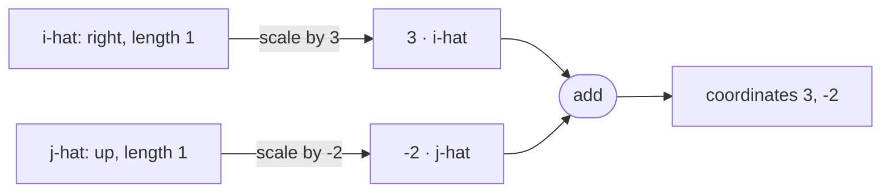
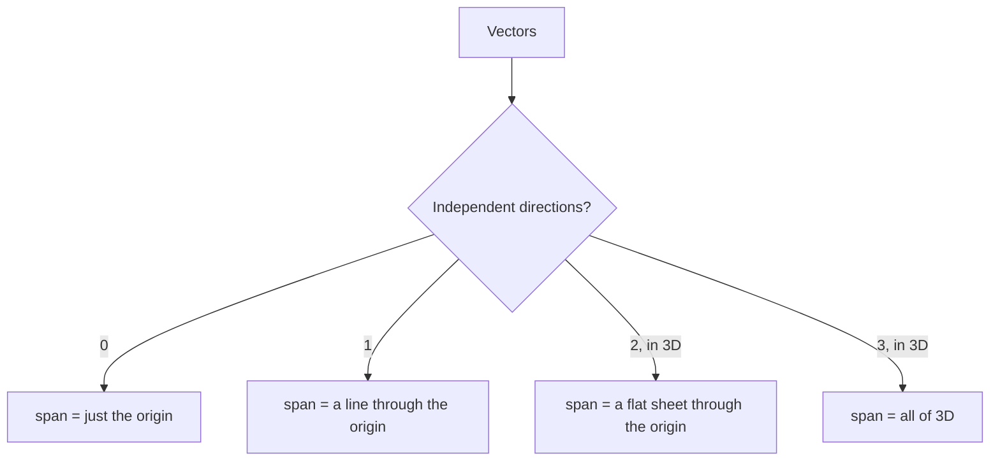
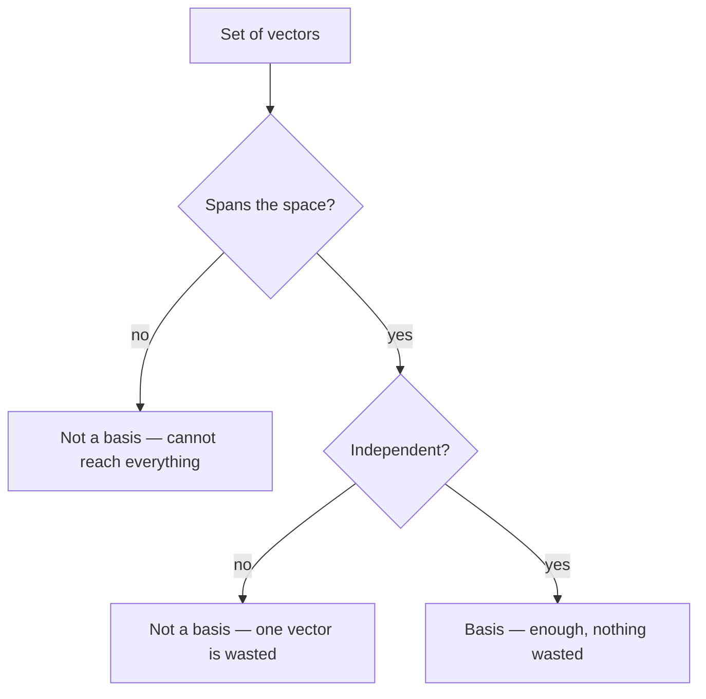

# Chapter 2: Linear Combinations, Span and Basis

Source: Essence of Linear Algebra (3Blue1Brown), Chapter 2. Revision notes, minimal clean markdown.

**One-line version:** every vector is a recipe — scale some building-block vectors and add them. The **span** is everything the recipe can make. A **basis** is the smallest set of building blocks that makes everything, with nothing wasted.

## 1. Coordinates Are Scalars

```text
i-hat = [1; 0]   length 1, pointing right
j-hat = [0; 1]   length 1, pointing up

[3; -2] = 3·[1; 0] + (-2)·[0; 1]
```

Read each coordinate as a scalar: stretch `i-hat` by 3, flip `j-hat` and stretch it by 2, then add. Together `i-hat` and `j-hat` are the **basis** — the vectors the coordinates scale.



**The basis is a choice.** You could pick two other vectors (say one up-right and one down-right) and still reach every point in the plane, but the numbers you write down would change. A list like `[3; -2]` only has meaning once you know which basis it refers to (more in Chapter 13).

## 2. Linear Combination

Scale some vectors, then add them:

```text
c1·v1 + c2·v2
```

The `c`'s are scalars (plain numbers); the `v`'s are vectors.

```text
2·[1; 3] + (-1)·[2; 0] = [2; 6] + [-2; 0] = [0; 6]
```

The x parts cancel, so the result sits on the y-axis.

**Why "linear"?** Fix one scalar and let the other change freely — the tip of the resulting vector draws a straight line.

## 3. Reaching a Target: Find c1 and c2

Question: which `c1`, `c2` make `c1·[1; 1] + c2·[1; -1] = [4; 2]`?

Write one equation per row (top, bottom), then add or subtract so one unknown cancels.

| Step | Work |
|---|---|
| 1. Top row | `c1 + c2 = 4` |
| 2. Bottom row | `c1 − c2 = 2` |
| 3. Add them | `2·c1 = 6`, so `c1 = 3` (c2 cancels) |
| 4. Put back | `3 + c2 = 4`, so `c2 = 1` |
| 5. Check | `3·[1; 1] + 1·[1; -1] = [3+1; 3−1] = [4; 2]` ✓ |

**Careful.** The 3 and 1 are the scalars `c1` and `c2`. The target `[4; 2]` only appears on the right of the equations — it is never multiplied by `c1` or `c2`. This method works only when the two vectors do not line up; if they do, most targets cannot be reached and there is no solution.

## 4. Span

The **span** of some vectors is the set of every vector you can reach with a linear combination of them. It answers: using only scaling and adding, where can I get to?

| Vectors | Shape of the span |
|---|---|
| both zero | just the origin |
| non-zero, lined up | a line through the origin |
| two in 2D, not lined up | the whole plane |

**Infinite does not mean everything.** A line has infinitely many vectors but misses almost every point in the plane. The useful question is the *shape* of the span.



**Arrows vs points.** For one vector on its own, think of an arrow. For a whole collection, think of just the tip of each as a point (tails still at the origin). Then "all vectors in the span" becomes a line or a sheet you can picture, instead of a crowd of arrows.

## 5. Span in 3D

- Two vectors (not lined up) span a **flat sheet** through the origin. Two knobs, `c1` and `c2`, reach every point on the sheet but cannot lift off it.
- Add a third vector:
  - **On the sheet** → it adds nothing; the span stays the same sheet.
  - **Off the sheet** → scaling it slides the sheet through space; the span becomes all of 3D.
- Two vectors can never span all of 3D. You need at least three.

## 6. Dependent and Independent

| Word | Meaning | Example |
|---|---|---|
| **Dependent** | At least one vector is redundant: it is already a linear combination of the others, so removing it does not shrink the span. | `[1; 0]`, `[0; 1]`, `[3; 5]` — since `[3; 5] = 3·[1; 0] + 5·[0; 1]` |
| **Independent** | Every vector adds a new direction to the span. Nothing is wasted. | `[1; 0]`, `[0; 1]` |

- **Two vectors:** is one a multiple of the other? `[2; 4] = 2·[1; 2]` → dependent. `[3; 1]` and `[1; 2]` are not multiples → independent, and they span the whole plane.
- **Three vectors:** is `v3 = a·v1 + b·v2` for some numbers `a`, `b`? If yes → dependent.
- **Memory trick:** *dependent* means one vector depends on the others, so it is not needed. Vectors pointing the same way are dependent, not independent.

## 7. Basis

> A **basis** of a space is a set of linearly independent vectors that span the space.

You need enough to reach everything (**spanning**) and none wasted (**independent**).



| Set of vectors | Spans plane? | Independent? | Basis? |
|---|---|---|---|
| `[1; 0]` alone | No (only the x-axis) | Yes | No: fails spanning |
| `[1; 0]`, `[0; 1]`, `[3; 5]` | Yes | No (`[3; 5]` is wasted) | No: fails independence |
| `[1; 0]`, `[0; 1]` | Yes | Yes | Yes |

## 8. Quick Reference

| Term | Plain meaning |
|---|---|
| Linear combination | scale vectors, then add |
| Span | everything you can reach with linear combinations |
| Dependent | one vector is a waste (already reachable from the others) |
| Independent | every vector adds a new direction |
| Basis | independent vectors that span the space |

## 9. Check Your Paper Work in NumPy

```python
import numpy as np
v1 = np.array([1, 1]); v2 = np.array([1, -1])
print(3*v1 + 1*v2)                  # [4 2]    the combination
A = np.array([[1, 1], [1, -1]])     # columns are v1 and v2
print(np.linalg.solve(A, [4, 2]))   # [3. 1.] finds c1, c2
# rank = number of independent directions (more in later chapters)
print(np.linalg.matrix_rank(np.array([[1, 2], [2, 4]])))   # 1: dependent
print(np.linalg.matrix_rank(np.array([[3, 1], [1, 2]])))   # 2: independent
```

## Remember

- Coordinates are scalars on the basis vectors.
- Span = every destination reachable by scaling and adding.
- Dependent = redundant; independent = every vector earns its place.
- Basis = spans the space **and** is independent.

---
[Index](README.md) | [← Previous](chapter-1-vectors.md)
