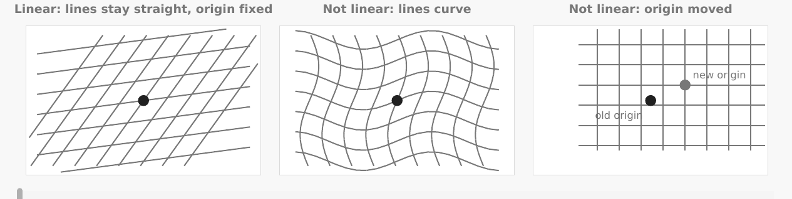
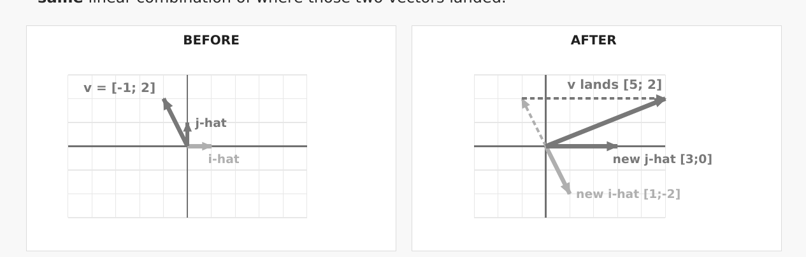
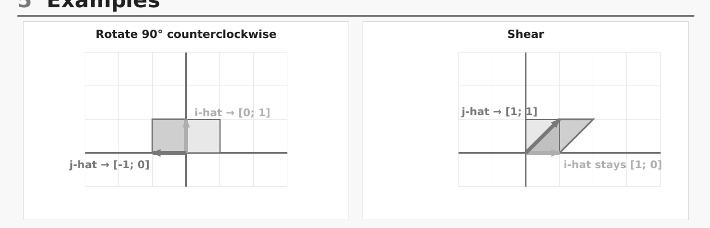
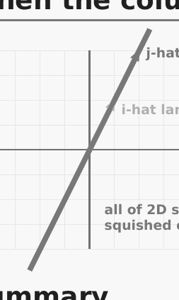

# Chapter 3: Linear Transformations and Matrices

Source: Essence of Linear Algebra (3Blue1Brown), Chapter 3. Revision notes, minimal clean markdown. Figures are grayscale crops from the original PDF — see [Reference images](#reference-images).

**One-line version:** a linear transformation moves all of space while keeping grid lines parallel and evenly spaced and the origin fixed. It is fully described by where `i-hat` and `j-hat` land, and those two landing spots written as columns make a matrix. So every matrix is a transformation of space.

## 1. What a Transformation Is

- Transformation = function. It takes a vector in and gives a vector out.
- Why not just say "function"? Because *transformation* suggests a picture: the input vector moves to the output vector.
- To see the whole transformation, imagine every vector moving at once. That is too crowded with arrows, so think of each vector as a point (its tip) and watch every point in space move to another point.
- In 2D, do this with all the points on an infinite grid, and keep a copy of the original grid in the background so you can see where things end up compared with where they started.
- The effect feels like squishing and morphing space itself.
- Nothing physical "happens". The movement is just a way to picture a function.

## 2. Linear: The Two Rules

Arbitrary transformations can look very complicated, so linear algebra only studies a special, easier type: **linear transformations**. Visually, a transformation is linear if:

- All lines stay lines (no curving), and
- The origin stays fixed.

Think of it as: grid lines stay parallel and evenly spaced.



*Figure 1 — left: linear (lines stay straight, origin fixed). Middle: not linear (lines curve). Right: not linear (origin moved). Chapter 3 PDF, p. 1; grayscale.*

> **Easy to get wrong**
> - Squishing is allowed. A linear transformation may flatten all of space onto a line. What is not allowed is bending lines or moving the origin.
> - Check a diagonal line, not just the grid. A transformation can keep the horizontal and vertical grid lines straight and fix the origin, but turn a diagonal line curvy — then it is not linear.
> - Examples of linear: rotation about the origin, shear, stretching. Not linear: moving every point 2 to the right (the origin moves).

## 3. The Key Idea: Only Track i-hat and j-hat

How would you give a computer a formula so that, given a vector's coordinates, it tells you where that vector lands? You only need to record where `i-hat` and `j-hat` each land. Everything else follows.

- Take `v = [-1; 2]`, which means `v = -1·i-hat + 2·j-hat`.
- Because grid lines stay parallel and evenly spaced, `v` lands at `-1·(where i-hat landed) + 2·(where j-hat landed)`.
- In other words: `v` started as a certain linear combination of `i-hat` and `j-hat`, and it ends up as the **same** linear combination of where those two vectors landed.



*Figure 2 — before: the original vector and basis. After: i-hat lands at [1; -2], j-hat at [3; 0], and v lands at [5; 2]. Chapter 3 PDF, p. 2; grayscale.*

Here `i-hat` lands at `[1; -2]` and `j-hat` lands at `[3; 0]`:

```text
-1·[1; -2] + 2·[3; 0] = [-1 + 6; 2 + 0] = [5; 2]
```

For a general vector `[x; y]`, it lands at `x·[1; -2] + y·[3; 0] = [1x + 3y; -2x + 0y]`.

The video could have just shown you where `v` lands. The point is the technique: with a record of where `i-hat` and `j-hat` land you can find where **any** vector lands without watching the transformation.

## 4. Four Numbers Make a Matrix

A 2D linear transformation is completely described by 4 numbers: the 2 coordinates of where `i-hat` lands and the 2 of where `j-hat` lands. Package them in a 2×2 grid: a matrix.

| | Column 1 | Column 2 |
|---|---|---|
| Top entry | `a` | `b` |
| Bottom entry | `c` | `d` |
| Meaning | where `i-hat` lands | where `j-hat` lands |

Matrix times vector, in the general case:

```text
x·[a; c] + y·[b; d] = [ax + by; cx + dy]
```

- Multiply the vector's coordinates by the matching columns, then add. This is exactly the Chapter 2 idea of adding scaled vectors, now applied to the new basis vectors.
- The matrix is just a way of packaging the information needed to describe the transformation.
- Putting the matrix on the left of the vector, like a function, is what is called **matrix-vector multiplication**. You could memorise the formula, but it is more intuitive to see the columns as the transformed basis vectors and the result as the right linear combination of them.

## 5. Examples



*Figure 3 — left: rotation 90° counterclockwise. Right: shear. Chapter 3 PDF, p. 3; grayscale.*

| Transformation | Where i-hat lands | Where j-hat lands | Matrix columns |
|---|---|---|---|
| Rotate 90° counterclockwise | `[0; 1]` | `[-1; 0]` | `[0; 1]` and `[-1; 0]` |
| Shear | `[1; 0]` (stays fixed) | `[1; 1]` | `[1; 0]` and `[1; 1]` |

- To find what a rotation or shear does to any vector, multiply its coordinates by that matrix.
- Going the other way: given a matrix, say columns `[1; 2]` and `[3; 1]`, first move `i-hat` to `[1; 2]`, then move `j-hat` to `[3; 1]`, and move the rest of space so grid lines stay parallel and evenly spaced.

## 6. When the Columns Are Dependent



*Figure 4 — if the landing spots line up, all of 2D space is squished onto one line. Chapter 3 PDF, p. 3; grayscale.*

- If the vectors that `i-hat` and `j-hat` land on are linearly **dependent** (one is a scaled version of the other), the transformation squishes all of 2D space onto a line.
- That line is the one-dimensional span of those two dependent vectors.
- This is the Chapter 2 idea of span and dependence showing up again.

## 7. Summary

- Linear transformations move space so that grid lines stay parallel and evenly spaced and the origin stays fixed.
- They can be described with just a handful of numbers: the coordinates of where each basis vector lands.
- Matrices are the language for this: the columns are those coordinates, and matrix-vector multiplication computes what the transformation does to a given vector.
- Every time you see a matrix, read it as a transformation of space.
- This idea makes later topics easier: matrix multiplication (next chapter), determinants, change of basis and eigenvalues.

## 8. Quick Reference

| Idea | Plain meaning |
|---|---|
| Transformation | a function that takes a vector in and gives a vector out |
| Linear | lines stay lines, origin fixed, grid stays parallel and evenly spaced |
| Matrix | a grid of numbers whose columns are where `i-hat` and `j-hat` land |
| Matrix times `[x; y]` | x times column 1, plus y times column 2 |
| Dependent columns | space gets squished onto a line |

> **Do not mix up**
> - The vector's coordinates are the scalars. You scale the new `i-hat` by `x` and the new `j-hat` by `y`. You are not multiplying the vector by `i-hat`.
> - Columns are the landing spots, not rows. NumPy takes a matrix row by row, so for columns `[1; -2]` and `[3; 0]` you type `[[1, 3], [-2, 0]]`.
> - Undoing a transformation is a separate matrix, the inverse (Chapter 7), not just the same numbers run backwards.

## 9. Check Your Paper Work in NumPy

```python
import numpy as np
# video example: i-hat lands at [1,-2], j-hat lands at [3,0]
A = np.array([[1, 3],
              [-2, 0]])            # typed row by row, read column by column
v = np.array([-1, 2])
print(A @ v)                       # [5 2]

R = np.array([[0, -1],
              [1, 0]])                       # 90 degree counterclockwise rotation
print(R @ np.array([1, 0]))                  # [0 1]   i-hat lands on column 1
print(R @ np.array([0, 1]))                  # [-1 0] j-hat lands on column 2

S = np.array([[1, 1],
              [0, 1]])                       # shear
print(S @ np.array([0, 1]))                  # [1 1]     j-hat moves to [1, 1]
```

## Reference images

All figures below are grayscale crops of the vector drawings in the original PDF. No diagrams were redrawn — what you see is the source material.

| Figure | File | Shows | Source |
|---|---|---|---|
| Fig 1 | [ch3-linear-vs-not.png](images/ch3-linear-vs-not.png) | linear vs curved lines vs moved origin | Chapter 3 PDF, p. 1 |
| Fig 2 | [ch3-before-after.png](images/ch3-before-after.png) | before/after transformation with landing spots | Chapter 3 PDF, p. 2 |
| Fig 3 | [ch3-rotation-shear.png](images/ch3-rotation-shear.png) | rotation 90° and shear | Chapter 3 PDF, p. 3 |
| Fig 4 | [ch3-dependent-columns.png](images/ch3-dependent-columns.png) | dependent columns squish space to a line | Chapter 3 PDF, p. 3 |

## Remember

- A matrix is a transformation of space.
- Columns = where the basis vectors land.
- To transform `[x; y]`: `x·column 1 + y·column 2`.
- Linear means lines stay lines and the origin stays put.

---
[Index](README.md) | [← Previous](chapter-2-span-and-basis.md)
